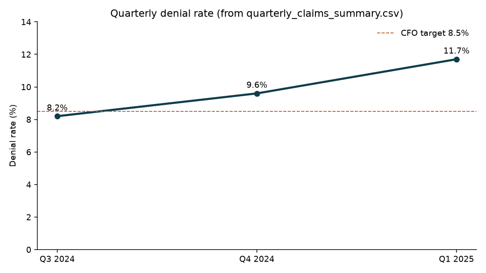
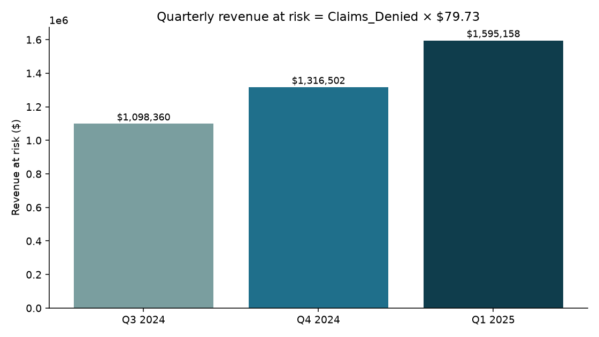
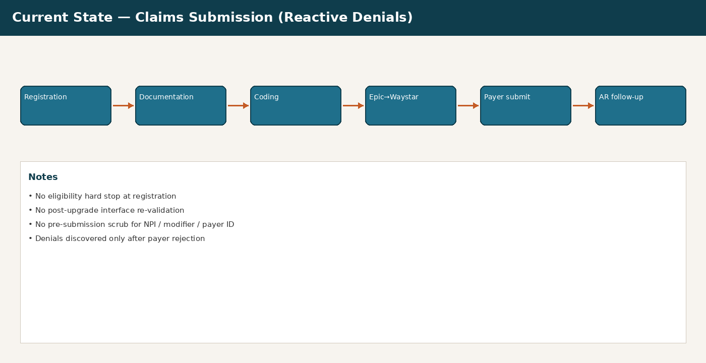
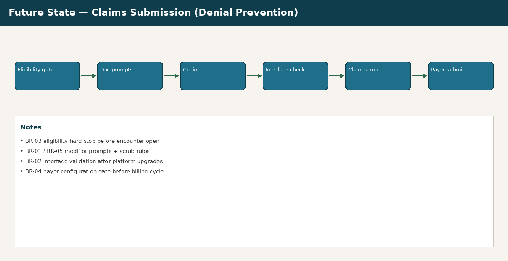
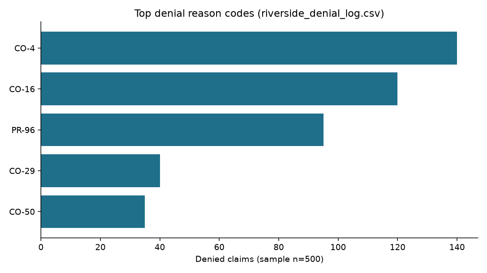

# Riverside Health System — Claims Denial Root Cause Analysis

**Business Analyst portfolio project** · Simulated healthcare revenue-cycle engagement  
**Tools:** SQL · Python · Excel · Power BI · workflow diagramming  
**Timeline:** August–September 2025 (5-week simulation)

> **Data disclaimer (read first):** Claim-level data in this repository is **synthetic**. Denial outcomes, clinics, payers, and claim IDs were generated for portfolio demonstration and **calibrated to CMS** Medicare Physician & Other Practitioners PUF 2024 (Wisconsin) allowed-amount benchmarks. Stakeholders and organizational details are fictional. No PHI is included. See [Data sources](#8-data-sources--dictionary) and `data/data_dictionary.md`.

---

## 1. At a glance

| Metric | Value | Source |
|---|---|---|
| Denial rate trend | **8.2% → 9.6% → 11.7%** (Q3 2024–Q1 2025) | `02_denial_analysis/sql/01_denial_rate_by_quarter.sql` · notebook `02_denial_eda` |
| Avg allowed amount | **$79.73** | `data/processed/analysis_constants.csv` |
| Incremental annual revenue exposure | **$1,897,574.00** | `05_revenue_at_risk.sql` 5B → `RECONCILED` |
| Top-3 denial share (sample) | **71.0%** (CO-4 28.0% · CO-16 24.0% · PR-96 19.0%) | `02_top_reason_codes.sql` |

**Headline formula:**  
`680,000 × (0.117 − 0.082) × $79.73 = $1,897,574.00`



---

## 2. Business problem

Riverside Health System (simulated regional nonprofit, Milwaukee, WI) submits **680,000** claims annually. Denial rate rose across three quarters; the CFO declined additional billing FTEs until root causes and a remediation plan were documented.

| Quarter | Denial Rate | Claims Submitted | Claims Denied | Revenue at Risk |
|---|---|---|---|---|
| Q3 2024 | 8.2% | 168,000 | 13,776 | $1,098,360.48 |
| Q4 2024 | 9.6% | 172,000 | 16,512 | $1,316,501.76 |
| Q1 2025 | 11.7% | 171,000 | 20,007 | $1,595,158.11 |

**Source:** `01_denial_rate_by_quarter.sql` and `05_revenue_at_risk.sql` (5A).  
**Formula:** `Revenue_at_Risk = Claims_Denied × $79.73`.



---

## 3. Engagement deliverables (maps to repo folders)

| Phase | Folder | Deliverable |
|---|---|---|
| 1. Charter | `01_project_charter/` | Project charter + client brief |
| 2. Denial analysis | `02_denial_analysis/` | Synthetic data generator, SQL profiling, notebooks |
| 3. Root cause | `03_root_cause_analysis/` | 5-Why RCA per top denial code |
| 4. Requirements | `04_brd/` | BRD with IDs and acceptance criteria |
| 5. Workflows | `05_workflow_diagrams/` | Current- and future-state claims submission |
| 6. UAT | `06_uat_plan/` | Test plan workbook + BRD↔UAT traceability matrix |
| 7. Dashboard | `07_power_bi_dashboard/` | DAX measures, screenshots, `.pbix` package |
| 8. Executive close | `08_executive_summary/` | CFO-ready one-pager |

Supporting assets: `data/` (raw CMS sample + processed outputs), `docs/images/` (README figures), MIT `LICENSE`, `requirements.txt`.

---

## 4. Repository layout

```
healthcare-claims-denial-analysis/
├── README.md
├── LICENSE
├── requirements.txt
├── .gitignore
├── data/
│   ├── raw/                      # CMS PUF filtered sample or download link
│   ├── processed/riverside_denial_log.csv
│   └── data_dictionary.md
├── 01_project_charter/
│   ├── project_charter_v1.1.md
│   └── client_brief_v1.1.md
├── 02_denial_analysis/
│   ├── sql/
│   │   ├── 01_denial_rate_by_quarter.sql
│   │   ├── 02_top_reason_codes.sql
│   │   ├── 03_payer_breakdown.sql
│   │   ├── 04_clinic_service_line.sql
│   │   └── 05_revenue_at_risk.sql
│   ├── notebooks/
│   │   ├── 01_synthetic_data_generation.ipynb
│   │   └── 02_denial_eda.ipynb
│   └── src/generate_synthetic_data.py
├── 03_root_cause_analysis/
│   └── rca_document.md
├── 04_brd/
│   └── brd.md
├── 05_workflow_diagrams/
│   ├── current_state_claims_submission.png
│   └── future_state_claims_submission.png
├── 06_uat_plan/
│   ├── uat_test_plan.xlsx
│   └── requirements_traceability_matrix.md
├── 07_power_bi_dashboard/
│   ├── denial_dashboard.pbix
│   ├── dax_measures.md
│   └── screenshots/
├── 08_executive_summary/
│   └── executive_summary.md
└── docs/images/
```

`data/processed/` also includes `quarterly_claims_summary.csv` and `analysis_constants.csv` (used by rate/RAR SQL). Helper scripts: `src/run_sql.py`, `src/verify_outputs.py`.

---

## 5. Findings and recommendations

Documented in `03_root_cause_analysis/rca_document.md` and summarized in `08_executive_summary/executive_summary.md`.

| Code | Root cause (summary) | Primary owner |
|---|---|---|
| **CO-4** | CMS modifier policy change (Jan 2025) not operationalized into Epic templates or pre-submission validation | Marcus Webb |
| **CO-16** | Dual track: Epic–Waystar NPI mapping failure on Medicare Advantage after Nov 2024 upgrade; West Allis registration/eligibility gap | James Tirado / Patricia Nguyen |
| **PR-96** | Three MA payer ID updates not confirmed in Waystar before Q1 2025 billing cycle | Sandra Kim / James Tirado |

**Planning target (not a measured output):** projected denial rate ~8.3% if remediation lands before Q4 2025 (CFO target ≤ 8.5%).





Requirements: `04_brd/brd.md` (BR-01–BR-06). UAT + traceability: `06_uat_plan/`.

---

## 6. Top denial drivers

| Code | Description | Share of Denials | Est. Impact |
|---|---|---|---|
| CO-4 | Inconsistent modifier / procedure code | 28.0% | $446,644.27 |
| CO-16 | Missing or incomplete claim information | 24.0% | $382,837.95 |
| PR-96 | Non-covered charge / payer ID mismatch | 19.0% | $303,080.04 |

**Source:** `05_revenue_at_risk.sql` (5C).  
**Formula:** `Est_Impact = denial-log share × Q1 2025 Revenue_at_Risk ($1,595,158.11)`.



---

## 7. Reproduce the numbers

```bash
python -m pip install -r requirements.txt
python 02_denial_analysis/src/generate_synthetic_data.py
python 02_denial_analysis/src/verify_outputs.py
python 02_denial_analysis/src/run_sql.py 02_denial_analysis/sql/01_denial_rate_by_quarter.sql
python 02_denial_analysis/src/run_sql.py 02_denial_analysis/sql/05_revenue_at_risk.sql
```

Notebooks:

1. `02_denial_analysis/notebooks/01_synthetic_data_generation.ipynb` — regenerate synthetic datasets  
2. `02_denial_analysis/notebooks/02_denial_eda.ipynb` — reproduce **8.2% / 9.6% / 11.7%** and RAR maths  

### Dollar / rate → query map

| Figure | Value | Query / artifact |
|---|---|---|
| Denial rates | 8.2% / 9.6% / 11.7% | `01_denial_rate_by_quarter.sql` |
| Avg allowed amount | $79.73 | `analysis_constants.csv` |
| Q3 / Q4 / Q1 revenue at risk | $1,098,360.48 / $1,316,501.76 / $1,595,158.11 | `05_revenue_at_risk.sql` 5A |
| Incremental annual exposure | $1,897,574.00 | `05_revenue_at_risk.sql` 5B |
| CO-4 / CO-16 / PR-96 est. impact | $446,644.27 / $382,837.95 / $303,080.04 | `05_revenue_at_risk.sql` 5C |

CI runs `verify_outputs.py` via `.github/workflows/verify.yml`.

---

## 8. Data sources & dictionary

| Source | How it was used |
|---|---|
| CMS Medicare Physician & Other Practitioners PUF 2024 | WI HCPCS charge/allowed anchors in `data/raw/cms_puf_wi_hcpcs_sample.csv`; avg allowed **$79.73** |
| Experian Health 2025 State of Claims Report | Qualitative industry context only — **not** used for dollar maths |
| Synthetic denial log | `data/processed/riverside_denial_log.csv` (500 rows) from `generate_synthetic_data.py` |
| CMS ANSI CARC | Official definitions for CO-4, CO-16, PR-96 and other codes |

Full column definitions: `data/data_dictionary.md`.

**Power BI note:** `07_power_bi_dashboard/denial_dashboard.pbix` is a portable package with rebuild instructions. Measures and verified values live in `dax_measures.md`; chart screenshots in `screenshots/` are generated from the same processed CSVs.

---

## 9. Skills demonstrated

- Python synthetic data generation calibrated to CMS PUF anchors  
- SQL denial profiling (reason code, payer, clinic, service line) with RAR reconciliation  
- Root cause analysis (5-Why)  
- BRD authoring with acceptance criteria  
- UAT design + requirements traceability matrix (BRD ↔ UAT)  
- Current/future-state workflow diagramming  
- Power BI measure design for revenue-cycle KPIs  
- CFO-ready executive communication  

---

## 10. License

MIT — see `LICENSE`.
