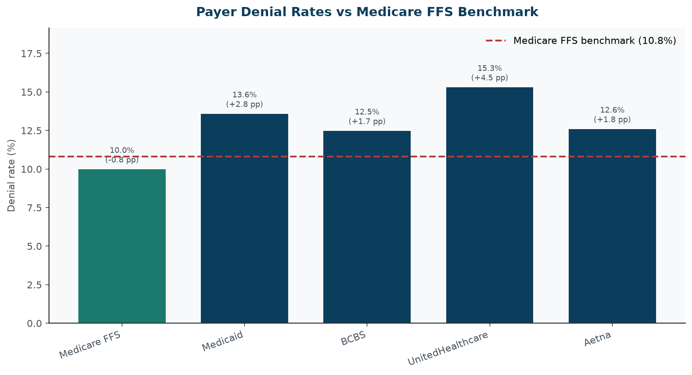
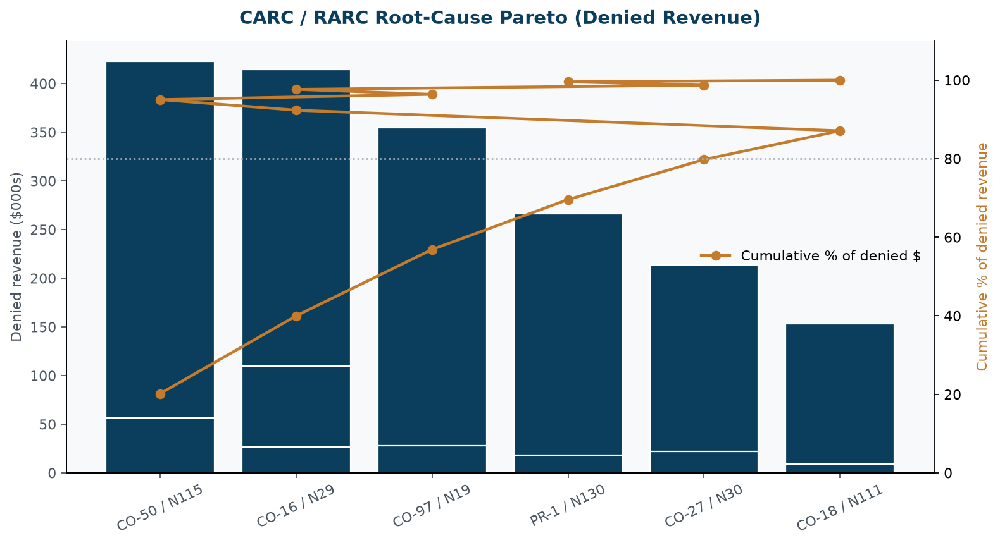
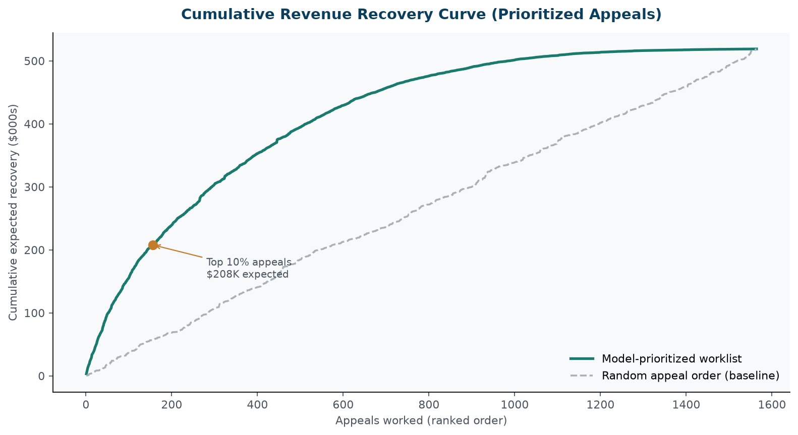

# Healthcare Revenue Cycle Management (RCM) & Claims Denial Analytics

**Enterprise portfolio project** · Synthetic hospital claims · Predictive appeal prioritization  
**Primary run path:** `python run_pipeline.py`  
**Stack:** Python · pandas · scikit-learn · matplotlib · Excel / openpyxl · Jupyter

> **Data disclaimer:** Claim-level data in this repository is **synthetic**. Patient identifiers are hashed (`HPT-*`). No PHI is included. Denial patterns are calibrated to industry benchmarks (Medicare FFS denial-rate reference **10.8%**). Stakeholders and organizational framing are fictional portfolio constructs.



---

## 1. Business problem

Hospital revenue cycle teams lose cash when denials rise above industry benchmarks and when appeal queues are worked FIFO instead of by expected recovery. This project builds an end-to-end RCM analytics system that:

1. Ingests / simulates an enterprise claims extract (~12,500 claims)
2. Validates schema and applies HIPAA-oriented sanitization
3. Computes Gross Denial Rate, Initial Clean Claim Rate, payer variance vs Medicare FFS, and recoverable revenue by root cause
4. Trains a Gradient Boosting model to predict appeal **Overturned/Recovered** outcomes and ranks a prioritized worklist
5. Publishes executive Excel / CSV outputs and visual analytics

Legacy BA engagement artifacts (charter, SQL profiling, BRD, UAT, Power BI stubs) remain under `01_`–`08_` for portfolio storytelling; **`run_pipeline.py` + `src/` is the primary runnable path**.

---

## 2. Architecture & methodology

```
python run_pipeline.py
        │
        ├─ src/etl_pipeline.py      → data/raw_claims.csv (~12,500 synthetic claims)
        ├─ src/schema.py            → canonical column contract
        ├─ src/data_validator.py    → validation + patient_id hashing
        ├─ src/carc_taxonomy.py     → CARC/RARC definitions, severity, recoverability
        ├─ src/payer_variance.py    → denial rates vs 10.8% Medicare FFS benchmark
        ├─ src/rcm_analytics.py     → KPIs + multi-tab Excel
        ├─ src/appeal_prediction.py → GradientBoosting overturn model + worklist
        ├─ src/model_evaluation.py  → ROC-AUC, Precision, Recall, feature importance
        └─ src/visualize_rcm.py     → reports/figures/*.png
```

| Layer | Module | Output |
|---|---|---|
| Data | `etl_pipeline` / `schema` / `data_validator` | `data/raw_claims.csv`, `data/processed_claims_sanitized.csv` |
| Analytics | `rcm_analytics` / `payer_variance` / `carc_taxonomy` | `output/claims_denial_kpi_summary.csv`, `output/rcm_executive_metrics.xlsx` |
| ML | `appeal_prediction` / `model_evaluation` | `output/appeal_worklist_prioritized.csv`, model metric CSVs |
| Visuals | `visualize_rcm` | `reports/figures/` |
| Exploration | `notebooks/denial_root_cause_deepdive.ipynb` | Interactive deep dive |

**Claim columns:** `claim_id`, `patient_id`, `service_date`, `claim_amount`, `payer_name` (Medicare FFS, Medicaid, BCBS, UnitedHealthcare, Aetna), `carc_code` (CO-16, CO-18, CO-27, CO-50, CO-97, PR-1), `rarc_code`, `denial_category` (Prior Authorization, Medical Necessity, Eligibility/Coverage, Timely Filing, Coding & Billing), `claim_status` (Paid / Denied), `documentation_completeness_score` (0–1), `appeal_status` (Overturned/Recovered, Upheld, Not Appealed).

---

## 3. Key financial findings *(pipeline outputs only)*

Figures below are produced by a fresh `python run_pipeline.py` run and sourced from `output/claims_denial_kpi_summary.csv` / `output/rcm_executive_metrics.xlsx`. Re-run the pipeline before citing.

| KPI | Value | Source |
|---|---|---|
| Total claims | **12,500** | ETL |
| Gross Denial Rate | **12.51%** | `claims_denial_kpi_summary.csv` |
| Initial Clean Claim Rate | **87.49%** | same |
| Total billed | **$16,353,385.49** | same |
| Denied revenue | **$2,094,501.77** | same |
| Estimated recoverable revenue (taxonomy-weighted) | **$924,794.71** | same |
| Actual recovered via overturned appeals | **$428,027.63** | same |
| Medicare FFS observed denial rate | **10.01%** (−0.79 pp vs 10.8% benchmark) | `Payer_Variance` sheet |
| Highest payer variance | **UnitedHealthcare 15.33%** (+4.53 pp vs benchmark) | same |
| Appeal overturn rate (among appealed) | **50.16%** (306 / 610) | KPI summary |



---

## 4. Model evaluation & appeal strategy

**Model:** `GradientBoostingClassifier` trained on appealed denials; scored across all denied claims.

| Metric | Hold-out value | Source |
|---|---|---|
| ROC-AUC | **0.7179** | `output/appeal_model_metrics.csv` |
| Precision | **0.6517** | same |
| Recall | **0.7532** | same |
| Accuracy | **0.6732** | same |
| Train / test sizes | 457 / 153 | `pipeline_run_summary.json` |

**Top features** (`output/appeal_feature_importance.csv`): documentation completeness score, log claim amount, CARC severity, payer weight.

**Operating strategy:** Work the ranked file `output/appeal_worklist_prioritized.csv` by `priority_score` / `expected_recovery`. The cumulative recovery curve contrasts model order vs random FIFO:



---

## 5. Reproduce

```bash
python -m pip install -r requirements.txt
python run_pipeline.py
```

On systems where only `python3` is available, use `python3 run_pipeline.py`.

Optional exploration:

```bash
jupyter notebook notebooks/denial_root_cause_deepdive.ipynb
```

**BA portfolio path (preserved):** `python 02_denial_analysis/src/verify_outputs.py` regenerates the Riverside 500-row denial sample and asserts legacy headline figures.

---

## 6. Repository layout

```
healthcare-claims-denial-analysis/
├── run_pipeline.py                 ← primary entrypoint
├── requirements.txt
├── src/                            ← enterprise RCM package
│   ├── etl_pipeline.py
│   ├── schema.py
│   ├── data_validator.py
│   ├── carc_taxonomy.py
│   ├── payer_variance.py
│   ├── rcm_analytics.py
│   ├── appeal_prediction.py
│   ├── model_evaluation.py
│   └── visualize_rcm.py
├── data/
│   ├── raw_claims.csv              ← generated by pipeline
│   ├── processed_claims_sanitized.csv
│   ├── raw/ · processed/           ← BA portfolio CMS-calibrated assets
│   └── data_dictionary.md
├── output/                         ← KPIs, Excel, appeal worklist
├── reports/figures/                ← RCM charts
├── notebooks/denial_root_cause_deepdive.ipynb
├── 01_project_charter/ … 08_executive_summary/   ← BA engagement deliverables
└── docs/images/                    ← BA README screenshots
```

---

## 7. Resume bullets (Data Analyst / Healthcare Analyst)

- Built an end-to-end **Healthcare RCM analytics pipeline** simulating **12,500** hospital claims with CARC/RARC taxonomy, HIPAA-oriented ID hashing, and executive Excel exports.
- Quantified **Gross Denial Rate (12.51%)** and **Initial Clean Claim Rate (87.49%)**, with payer denial variances vs a **10.8% Medicare FFS** benchmark (UnitedHealthcare **+4.53 pp**).
- Estimated **$924.8K** recoverable denied revenue by root cause and tracked **$428.0K** actual overturn recoveries in the synthetic appeal cohort.
- Trained a **Gradient Boosting** appeal-overturn model (**ROC-AUC 0.72**, Precision **0.65**, Recall **0.75**) and shipped a ranked appeal worklist with cumulative recovery ROI visuals.
- Preserved a full BA engagement packet (SQL profiling, BRD, UAT, Power BI measures) alongside the production-style `src/` architecture for dual-track portfolio storytelling.

---

## 8. Legacy BA portfolio (Riverside engagement)

The numbered folders `01_`–`08_` document a simulated Riverside Health System denial spike analysis (8.2% → 11.7%). Headline BA figures remain reproducible via `02_denial_analysis/src/verify_outputs.py` and are independent of the enterprise RCM pipeline above.

| BA metric | Value |
|---|---|
| Denial rate trend | 8.2% → 9.6% → 11.7% |
| Incremental annual revenue exposure | $1,897,574.00 |
| Top-3 denial share (sample) | 71.0% (CO-4 / CO-16 / PR-96) |

See `data/data_dictionary.md` and `08_executive_summary/executive_summary.md` for that engagement track.

---

## License

MIT — see `LICENSE`.
